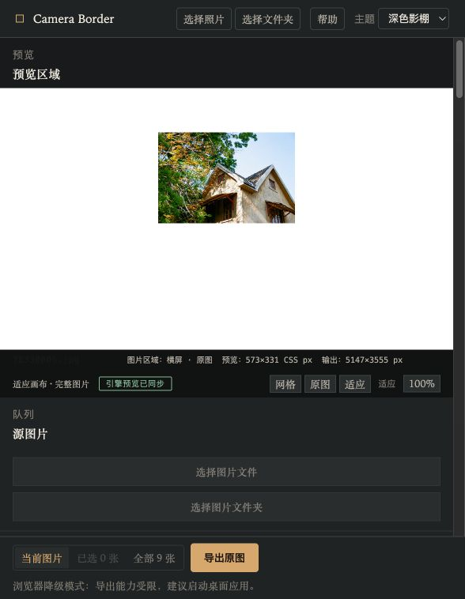
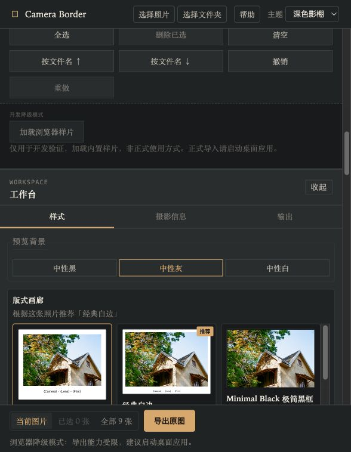
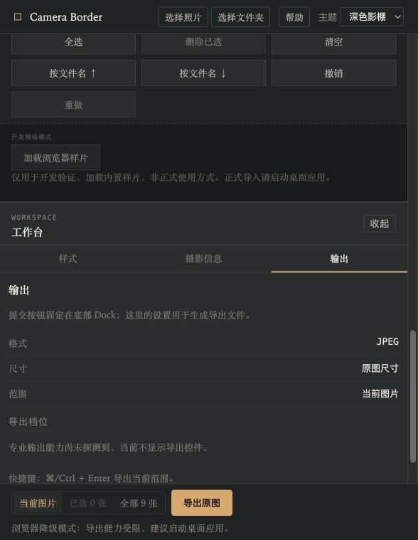
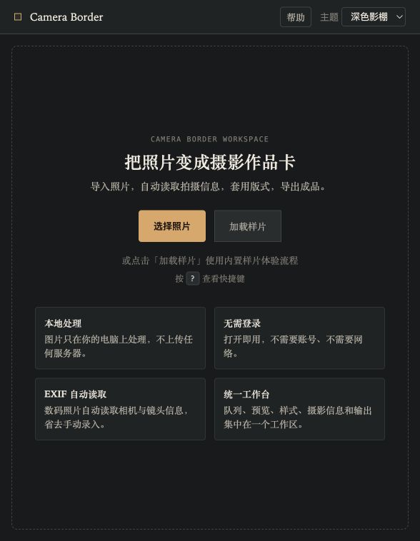
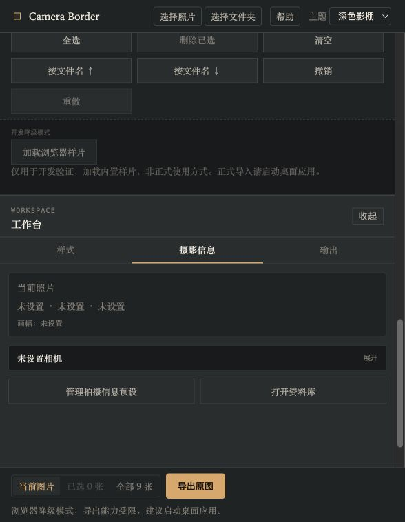
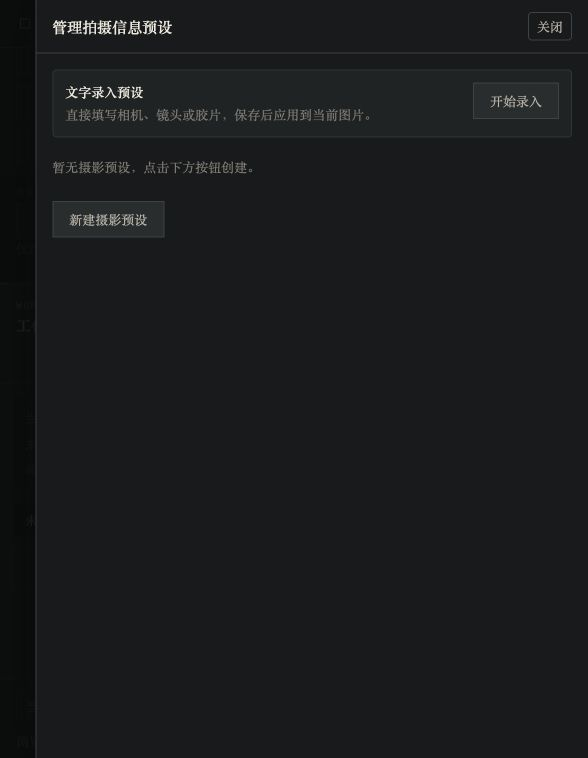
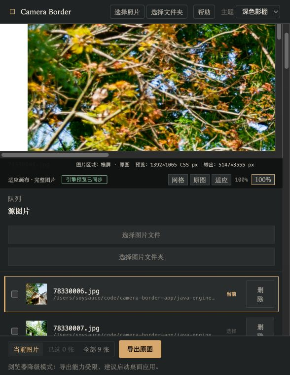

# 工作台体验与性能优化方案

审查日期：2026-10-27。基线：`0641bf9` 加本次审查开始时已有的未提交改动。

本文是优化建议，不替代 [PRD §0](prd.md)、[架构规则](../ARCHITECTURE.md) 和发布验收。当前工作区的交互改动已纳入观察；本次不修改业务代码。

## 1. 结论与范围

项目已经具备导入、队列、版式、摄影信息、预览、单图与批量导出的主要能力，也已有撤销、会话恢复、失败重试、引擎诊断和性能保护。下一阶段最有价值的工作，是让这些能力更准确、更容易理解、更稳定地响应操作。

建议依次推进：

1. **可信**：修复预览几何与原图像素查看，统一范围、取消和导出状态的含义。
2. **易用**：压缩日常操作需要面对的控件，统一文字编辑和预设入口，让用户始终知道在改什么。
3. **顺畅**：减少画廊重复绘制、限制元数据并发，补上渲染进程的性能测量。
4. **完整**：完善源文件重定位、批量命名、失败处理和真实摄影用户验证。

### 本次证据边界

- 已检查：根目录规则、产品与模块文档、关键 React/Electron/Java 实现；在浏览器开发模式运行当前前端和本地 Java 引擎，体验样片流程并保存截图；补充两种尺寸的引擎预览请求。
- 浏览器实际视口为 **588×758，DPR 2**。截图反映该视口下的行为，不能据此认定桌面三栏布局存在同样的纵向堆叠。Electron 配置的默认窗口为 1400×920，最小窗口为 1200×760，桌面尺寸需要另测。
- 桌面开发启动被本机 Electron 运行时签名校验阻断：`Electron Framework.framework` 报 `bundle format is ambiguous`。这是当前开发环境问题，尚不能推断安装包也有同样问题。本次没有重装依赖或修改签名脚本。
- 未执行：系统文件选择与拖放、实际文件导出、原图与导出文件独立像素/ICC/元数据对照、安装包、断网、读屏器、大队列端到端压测及摄影用户访谈。
- 已通过：前端类型检查、前端测试、Electron 类型检查。前端测试出现 jsdom 的 Canvas `getContext` 未实现提示，测试通过不能替代真实像素校验。本次没有修改 Java 代码，也未运行 Java 全量测试。
- “已复现”来自本次界面/API；“源码确认”表示实现可直接确认；“待测风险”是需要测量或用户验证的判断。

## 2. 当前值得保留的基础

- 三个子系统职责明确；预览、导出围绕同一份 `RenderRecipe` 装配。
- 当前预览图与批量勾选独立，避免点击图片就改变批量集合。
- 工作台采用样式、摄影信息、输出三个页签，管理能力使用抽屉。
- 队列缩略图已按可见范围加载，限制并发，并有按字节预算淘汰的缓存。
- 导出已有配方冻结、预检、有界任务、部分失败反馈、取消、失败项重试。
- 已有队列与设置持久化、丢失文件标记、两类撤销历史；应补齐一致性，而不是重新建设。
- 抽屉已有焦点约束、关闭后焦点恢复，CSS 已处理减少动态效果偏好。

## 3. 本次流程记录

步骤按实际体验顺序记录；图片均为本次截图，无模拟界面。截图较窄，部分队列内容和控制项需要滚动查看。

| 步骤 | 操作与截图 | 健康度 | 主要观察 |
|---|---|---|---|
| 1 | 首次进入：[欢迎页](ux-audit-20261027/01-welcome.jpg) | 基本清晰 | 价值与导入入口明确；正式桌面入口与浏览器样片入口有意不同 |
| 2 | 加载样片：[默认预览](ux-audit-20261027/02-workspace.jpg) | 需优先修复 | 图片被明显过大的留白挤小；预览却显示“已同步” |
| 3 | 切换输出：[输出页](ux-audit-20261027/03-output.jpg) | 反馈不足 | 能力不足显示“尚未探测到”，没有说明具体缺项；主按钮仍显示“导出原图” |
| 4 | 查看摄影信息：[信息页](ux-audit-20261027/04-photo-info.jpg) | 有改进空间 | 空字段显示多个“未设置”，未直接说明是缺信息、读取中还是读取失败 |
| 5 | 打开预设管理：[预设抽屉](ux-audit-20261027/05-preset-drawer.jpg) | 入口可合并 | “文字录入预设”和“新建摄影预设”并列，用户需要先理解两条创建路径 |
| 6 | 返回样式：[版式画廊](ux-audit-20261027/06-style-gallery.jpg) | 需收敛 | 画廊内滚动嵌在面板滚动中，卡片仍显示变量占位符；大量屏幕外卡片已建 Canvas |
| 7 | 点击 100%：[像素查看](ux-audit-20261027/07-pixel-view.jpg) | 语义不准确 | 实际以 1280×849 代理图计算，合成视图为 1392×1065，而界面输出摘要为 5147×3555 |

### 关键截图

步骤 2：在适应画布模式下，照片只占约 173×115 CSS 像素，整个画布为 573×331。

步骤 6：版式卡片显示当前照片，但文字仍出现 `{Camera}`、`{Lens}`、`{Film}`。

步骤 3：引擎已完成能力返回，但没有可用专业档位时，输出页仍使用“尚未探测到”的说明。

其余步骤的完整截图见表内链接。原始数值见 [观察记录](ux-audit-20261027/observations.json)、[预览几何响应](ux-audit-20261027/engine-preview-geometry.json) 和 [本轮能力快照](ux-audit-20261027/capabilities.json)。这些是一次审查的快照，不是固定产品规格。

## 4. 问题清单与优先级

此处优先级用于本轮体验优化，不改写原有任务编号。P0 是核心结果可信度问题；P1 影响高频操作或恢复；P2 是后续效率和视觉完善。

| 编号 | 优先级 | 问题 | 证据级别 | 归属 |
|---|---|---|---|---|
| U01 | P0 | 适应画布时只缩照片、未统一缩放配方几何；不同预览尺寸的留白比例改变 | 界面/API 复现，源码确认 | frontend preview；java-engine render |
| U02 | P0 | 100% 以代理图作为自然像素尺寸，不能可靠用于原图细节判断 | 界面复现，源码确认 | frontend preview；必要时 java-engine preview |
| U03 | P1 | 版式缩略图未使用同一份有效摄影信息，信息卡变体缩略图固定使用基础白边版式 | 截图与源码确认 | frontend template/metadata |
| U04 | P1 | 范围按钮、单图按钮、全局样式三种作用域容易混淆；按钮“导出原图”与实际设置不总一致 | 截图与源码确认，误解程度待用户测试 | frontend workspace/export/settings |
| U05 | P1 | 全局 Cmd/Ctrl+Z 只撤销队列；修改版式/边框后不会按最近操作撤销 | 源码确认 | frontend workspace/settings/queue |
| U06 | P1 | 导出准备阶段显示取消，但无 jobId 时取消函数直接返回；轮询失败被当作任务失败 | 源码确认，故障场景待复现 | frontend export/client |
| U07 | P1 | 能力探测的加载、错误、组件缺失收敛成同一提示，恢复动作不明确 | 截图/API/源码确认 | frontend output/engineHealth |
| U08 | P1 | 画廊同时绘制屏幕外 Canvas，每次 settings 引用变化可能引发整组重绘 | DOM 与源码确认；卡顿程度待测 | frontend template/preview |
| U09 | P1 | 导出前元数据读取无并发上限；读取失败与确实无 EXIF 都降级为空 | 源码确认；高负载程度待测 | frontend metadata/export |
| U10 | P1 | “画廊＋详细参数”和“快捷文字＋文字图层”重复增加理解与滚动成本 | 截图/界面结构确认 | frontend settings/template |
| U11 | P1 | 源文件缺失可标记，但没有保留编辑的重定位接口；重新导入不能代替恢复绑定 | 类型与恢复代码确认 | frontend queue；electron IPC |
| U12 | P2 | 摄影信息空态与两条预设创建入口不够直观，术语仍有漂移 | 截图与文案确认 | frontend metadata |
| U13 | P2 | 批量命名、筛选和结果查看需要更明确的工作流，长列表结果会挤占 Dock | 源码确认，需求收益待用户验证 | frontend queue/export；electron 文件能力 |
| U14 | P2 | 小字号、键盘分栏和队列复合控件语义需要完善 | CSS/源码确认；对比度和读屏待测 | frontend layout/styles/queue |
| U15 | P1 | 已有引擎性能 smoke，但缺少本轮前端实际交互延迟与目标摄影用户证据 | 验证范围确认 | 测试与发布文档 |

## 5. 具体优化设计

### 5.1 先让预览可信：U01、U02、U03

**已观察到的链路问题**

- Canvas 的 `calculatePreviewImageLayout` 从视口宽高直接减去配方的边框像素，再缩放照片。样片的下边框 160px 在 331px 高的预览中仍占 160px，导致照片高度只剩约 115px。
- Java `compose` 先对子采样/缩小后的照片做布局，再附加未等比缩放的边框和文字。同一配方分别请求 640 与 1280 的预览，合成尺寸分别为 752×640 与 1392×1065，留白比例随请求改变。只共享 DTO 不能保证视觉一致。
- Canvas 的文字还有 `cw / 800` 的缩放路径；需要连同字号、偏移、Logo、线宽一起核对，不能只修边框。
- 主预览“100%”自然尺寸取自 `currentImage.naturalWidth/Height`，当前载入的是最长边 1280 的代理图；知道原图尺寸并显示输出摘要，没有改变实际绘制来源。
- 画廊的 `LiveTemplateThumbnail` 接收原始设置，没有主预览的有效文字、每图覆盖与品牌解析；信息卡缩略图始终合并 `baseTemplate`，切换黑边/左下后不能正确展示当前变体。

**建议实现**

1. 以原图方向归一后的尺寸计算配方的逻辑合成空间；只把最终合成空间统一映射到预览视口。代理图仅替换像素来源，不改变边框、文字和布局的逻辑尺寸。
2. Java 继续使用低分辨率解码控制内存，但按同一逻辑空间和比例缩放所有渲染参数；保留共享 `RenderRecipe`，不再建一套预览配置。必须明确导出尺寸档位与加边框后尺寸的关系，并与 PRD/现有预检保持一致。
3. 100% 模式按原图逻辑坐标定位，按需载入可视区域的真实像素。若当前阶段不提供真实像素，明确显示“代理预览”，不能把插值放大当成原图细节。不要为解决 100% 一次性加载整批原图。
4. 主预览、版式缩略图复用有效摄影信息解析；选中变体用实际变体设置。无摄影信息时展示真实空态，不用未解析变量伪装成成品。
5. “引擎预览已同步”只表达请求完成；正确性由固定样片的像素与几何验证证明。

**验收**

- 同一配方在不同视口、DPR、横竖方向下，边框和文字相对于合成画面的比例不变。
- Canvas、引擎预览、单图导出、批量导出的边框/裁切/字号/Logo 均一致；先比布局关键点，再用容差适当的图像比对，避免要求不同文字渲染器逐像素相同。
- 原图坐标中的可视区域能够与导出同区域对应；使用高频细节样片验证真实像素来源。
- 黑白边、左下/居中变体、中文长文字、缺字段、每图覆盖、Orientation 1–8 都有成功和失败/退化用例。

源码入口：[PreviewPanel](../frontend/src/features/preview/components/PreviewPanel.tsx)、[Canvas 渲染](../frontend/src/features/preview/canvas/canvasRenderer.ts)、[预览加载](../frontend/src/features/preview/hooks/usePreview.ts)、[Java 合成](../java-engine/src/main/java/com/camborder/app/service/impl/Java2DImageRenderService.java)、[画廊](../frontend/src/features/template/components/TemplateGallery.tsx)、[实时缩略图](../frontend/src/features/template/components/LiveTemplateThumbnail.tsx)。

### 5.2 让范围和撤销符合直觉：U04、U05

**当前实现**：样式由一份全局 `settings` 驱动，队列项只有文字与摄影信息覆盖；共享 `operationScope` 用于预设应用和导出。Dock 即使选了“全部”，仍会同时显示主按钮“导出原图”和另一个批量按钮。快捷键按范围导出，主按钮则固定单图，鼠标与快捷键含义不同。

**近期方案**：

- 在样式页明确显示“整组共用版式”，摄影信息页显示“当前图片的覆盖”；范围控件标注用途，不能暗示范围会控制尚未实现的每图版式。
- 底部只保留一个主要导出动作，直接写“导出当前图片”或“导出已选 N 张/全部 N 张”；点击与 `E`、Cmd/Ctrl+Enter 共用同一命令。
- Dock 增加紧凑摘要，例如“标准交付 · JPEG · 原图像素＋边框 · 保留位置”。摘要必须从实际设置/预检生成；快速分享时不能继续写“原图尺寸”。
- 批量预设应用前显示影响范围和数量，完成后显示“已应用到 N 张”并支持撤销；不为每次正常操作增加确认弹窗。
- 用轻量的操作顺序协调已有队列/设置历史，使全局撤销还原最近一次可撤销操作；编辑文本时保留输入框原生撤销。撤销按钮写出动作名称，避免“撤销”含义不清。

**后续能力**：如果混合版式是高频需求，再引入每图版式覆盖和“同步到已选”，明确继承、覆盖和重置规则。这是数据模型变化，应单独立项，不能只给现有全局设置套一个范围按钮。

**验收**：连续“改边框→改当前图片文字→移动队列→撤销/重做”顺序正确；任一范围下鼠标与快捷键导出目标一致；空选集有明确反馈；操作不改变原图。

### 5.3 收敛信息层级：U10、U12、U14

- 样式页优先展示少量精选/最近使用版式，“全部版式”按需展开；搜索、分类和收藏在版式数量继续增长时加入。画廊不要长期占据详细编辑器之前的大块空间。
- 日常参数先展示：边框粗细与颜色、文字内容、信息字段、位置。图片区域、渐变、图层效果、Logo 等按需展开，记住展开状态。
- 把“快捷文字”改成同一文字图层的基础编辑视图；高级编辑展开该图层，避免两组看似独立的表单同步修改一个值。
- 预设管理统一为“新建拍摄信息预设”：默认直接填写，资料库引用是可选补全。把“保存”和“保存并应用到 N 张”写清楚；沿用必填校验，不降低数据质量要求。
- 信息页空态区分“正在读取”“未包含拍摄信息”“读取失败”；提供“直接补充”与“选择预设”。不要只连续显示“未设置 · 未设置 · 未设置”。
- 样式页“画幅格式”与摄影信息中的“拍摄画幅”容易混淆，按现有契约改为“拍摄画幅”和“边框布局建议”，明确不会自动裁剪。
- 保留深色影棚、暖灰和预览背景能力，先优化层级与留白，不做整套视觉翻新。
- CSS 正文字号 token 当前约 13px，设计文档要求正文不低于 14px；统一规范并实测。小号元数据只能承载次要内容，不能用缩字解决面板拥挤。
- 分栏手柄补充键盘调节、可访问名称与数值；队列行的 `role=button` 内含复选框和删除按钮，需要重做复合控件语义并实测读屏，不能只看截图宣布无障碍通过。

**桌面布局原则**：在 1200×760、1400×920、常见高分屏和文字放大场景分别验收。先保证预览有可用空间；若侧栏宽度挤压中心，提供紧凑队列/收起面板。窄视口属于补充适配，不能把本次浏览器纵向布局当成桌面主设计依据。

**验收**：不用帮助也能找到改字、改边框、批量范围和导出；纯键盘完成核心流程；模态焦点不逃逸且关闭后返回；对比度、焦点、字号和减少动态效果分别验证。

### 5.4 针对真实链路改善流畅性：U08、U09、U15

**已具备的保护不重复建设**：队列缩略图可见加载、双并发、LRU、预览取消，以及 Java 内存 smoke 都已存在。

**首要瓶颈候选**：

1. 本轮 DOM 观察到画廊已建立 27 个 Canvas，总 backing pixels 约 1791 万；单份 RGBA 理论缓冲约 68 MiB，实际进程占用还受浏览器和 GPU 影响，不能把它当成测得 RSS。`TemplateGallery` 每次创建合并设置对象，`LiveTemplateThumbnail` 的 effect 依赖整个对象，可能使无关设置变化也重绘全部卡片。
2. 每张卡片单独创建缩小用 Canvas；最长边上限针对代理照片，不包括附加边框。缓存 URL 的字节预算不覆盖这些 Canvas 像素缓冲。
3. `ensureExifForExport` 使用全量 `Promise.all`，并发量随批量规模增长；每个结果更新 Map 和 React 状态。EXIF 缓存只按路径，与缩略图已有的 mtime/size 版本语义不一致。
4. 后台引擎合成预览返回的 `engineDisplayUrl` 被保存但未在展示组件消费；它目前主要贡献状态和报告。需要先明确“可信预览”的产品用途，再决定何时请求和如何展示。

**实施顺序**：

- 先采样主线程长任务、绘制耗时、图片切换耗时和进程内存，分别记录冷缓存/热缓存。
- 画廊只绘制可见卡片加少量预加载；按实际显示尺寸与受限 DPR 绘制，共用当前照片的小代理，按照片版本、版式、有效文字生成缓存键。
- 用稳定的渲染输入避免修改输出路径、范围、无关状态触发画廊绘制；持续拖动合并到动画帧，拖动结束再触发高质量引擎同步。减少绘制不能改变最终配方。
- EXIF 使用小规模有界并发，批量发布状态，并能取消等待；失败单独记录，可重试。照片确无 EXIF 时无需人为阻断导出，但读取失败不能伪装为没有信息。
- EXIF 与图片代理统一使用文件版本失效逻辑；增加移出/返回可见区的命中率指标，测得需要后再调整缩略图的释放策略。
- 只有实测显示 DOM 数量是瓶颈时才引入队列虚拟列表；不因为“可能有大量照片”直接新增状态框架或 Worker。

**建议性能目标，尚未达成验收**：

| 动作 | 首轮目标 | 测量口径 |
|---|---|---|
| 点击/勾选等操作反馈 | P95 ≤100ms | 输入到选中态/反馈绘制；独立于照片解码 |
| 已缓存照片切换 | P95 ≤200ms | 输入到正确照片可见 |
| 连续调参 | 主线程单次重绘尽量 ≤16.7ms | 固定样片和机器；记录 >50ms 长任务，不能只报平均帧率 |
| 未缓存图片加载 | 有明确加载阶段，可取消 | 按格式/像素/冷暖缓存分类，先量基线再定时延预算 |
| 百张照片连续处理 | 两轮后无持续单调增长或无界排队 | Electron 主进程、Renderer、Java 分别记录；延用已有 Java 门槛，新增前端预算由实测制定 |

成功与失败路径都覆盖：快速连切、请求超时、引擎重启、损坏文件、TIFF/HEIC、长文字、窗口缩放、任务进行中改参数。不要把 HTTP smoke 当成 UI 流畅性证明。

### 5.5 导出要能解释和恢复：U06、U07、U13

- 能力展示明确区分“检查中 / 已就绪 / 缺组件 / 请求失败”，列出缺少的随包组件，提供重新检查和诊断入口。能力不足时保留解释，隐藏实际不可用参数；不要让用户安装外部依赖来完成正常使用。
- 档位不可用时，在用户选择保存位置之前解释原因，并禁止无意义提交；继续保留后端预检，避免前端状态失真。不能为了“按钮能点”降低保真要求。
- 保真摘要展示实际尺寸、位深、色彩/ICC、GPS/位置策略和 RAW 像素来源。将“原图”分别表达为“查看原始照片”“原图尺寸导出”，避免同词多义。
- 准备阶段增加本地取消令牌，取消后后续 EXIF/预检/选择器返回不得再提交；jobId 已存在时才发送引擎取消。取消请求失败时继续保留任务状态和查询入口。
- 查询超时/断线使用“状态待确认”，保留 jobId 和冻结快照，优先查询原任务；当前实现的异常会清空活动引用并置 error，重新提交存在重复任务风险。提交响应丢失时没有 jobId，应明确结果未知，核对输出/任务记录，必要时另行设计提交标识，不自动重发。
- 遵守现有内存任务存储 ADR：同进程可恢复查询；引擎重启后查不到任务，应解释“任务记录已失效，需核对输出”，不能声称已自动续跑。
- 结果摘要固定在 Dock，逐文件详情放可展开列表/抽屉；显示成功、失败、取消、待确认，失败按原因分组，并提供定位文件/打开目录/仅重试失败。
- 命名可先提供“原文件名＋后缀”“自定义前缀＋序号”，显示若干实际名称样例。已存在目标继续默认阻断，允许显式选新目录或自动编号，绝不静默覆盖。

**验收**：准备阶段取消、提交中断线、GET 超时后恢复、取消失败、部分成功、重试、路径冲突、无权限都能解释；不可把“查询失败”报告成“文件必然未生成”；新任务不错误沿用旧预检结果。

### 5.6 让批量和长任务真正可继续：U11、U13

- 队列恢复时显示简短摘要：“已恢复 N 张，M 张找不到源文件”，提供继续、移除缺失、重新定位。
- 重定位更新原条目路径，保留文字覆盖、预设绑定、排序和选中；支持文件夹级查找，但遇到同名候选要显示路径/尺寸等信息由用户确认，不能静默绑定。
- 批量队列先加入名称搜索、仅看失败/缺失/已覆盖信息等必要筛选；Shift 连续勾选和紧凑缩略图视图根据用户任务验证后加入。
- 下一阶段再考虑可命名的本地工作会话，用于恢复不同照片组；当前自动恢复已经存在，不作为全新能力重复立项。

**验收**：移动源文件后仍可恢复原编辑；HEIC 临时工作文件能按原始来源重建；重启不把已完成导出再次执行；损坏的会话保留可解释提示，不悄悄清空用户工作。

## 6. 实施分期与依赖

以下是一个熟悉代码的工程师的初步估算，含必要回归，不是交付承诺。预览逻辑和真实像素方案验证后应重新估算；签名、安装包验收、外部摄影用户安排另计。

| 阶段 | 范围 | 依赖与完成条件 | 估算 |
|---|---|---|---|
| A：准确与可预期 | U01/U02；U04/U05；U06/U07 的状态和取消修正 | 先定逻辑合成空间；通过四链路、范围、撤销和失败恢复验证 | 5–8 工程日 |
| B：高频操作与流畅性 | U03/U08/U09/U10/U12/U14 的主要问题 | 基于阶段 A 的稳定渲染输入；采集优化前后同机性能 | 5–8 工程日 |
| C：批量完善与验收 | U11/U13/U15；完整像素查看按需加载若 A 未完成 | 重定位/命名/结果列表完成；桌面安装包与摄影用户验证 | 4–7 工程日 |

推荐先拆出五个可独立评审的小任务：

1. **统一预览逻辑坐标与代理像素映射**：frontend preview 与 Java render 分开修改、用同一组样片交叉验收。
2. **统一主导出命令与摘要**：归 frontend，先纠正文案、范围和点击/快捷键一致性。
3. **补齐准备取消和状态待确认**：归 frontend export；仅在确需提交去重协议时单独改 Java API。
4. **全局撤销协调与文字编辑收敛**：归 frontend，复用现有历史，避免全局状态重构。
5. **画廊正确性与可见绘制**：归 frontend template/metadata，先修有效信息和变体，再测并减少绘制。

文件重定位涉及 Electron 白名单能力和前端状态，单独安排接口任务；不把它夹在样式优化中跨模块顺手重构。文档与截图置于既有 `docs/`；证据子目录仅用于保存本轮审查材料，没有新增运行时分层。

## 7. 验证与发布条件

- 每项行为变化同步模块 README/cookbook；明确共享配方、摄影身份和输出设置的职责。
- 按模块运行 [CONTRIBUTING](../CONTRIBUTING.md) 的检查；新增接口按架构规则覆盖空 body、缺字段、非法枚举、非法尺寸。
- 补充真实渲染回归，避免继续只校验对象字段或 mock Canvas 调用。失败证据即使后续重试成功也保留。
- 按 [现有性能脚本](../scripts/performance-smoke.mjs) 检查 Java，再独立测 UI 主线程和 Electron/Renderer 内存。
- 按 [摄影用户测试模板](user-study-stage6.md) 执行首次导入、选版式、修改、范围导出与 RAW 认知任务，保留其现有首次出图门槛，不用开发者自测替代。
- 正式发布仍只按 [发布范围](release-scope.json) 验收 macOS arm64；候选平台不冒充正式通过。
- 测试输出、截图和文档分析均不能代替已安装同版本应用的导入、预览、实际导出和保真独立核验。

## 8. 本轮不建议优先扩展

不优先增加更多装饰版式、AI 生成、在线商店、登录、云同步、修图或真实 RAW 显影。前几项会继续增加已有的信息与性能负担，后几项也不属于当前 PRD 契约。每图独立版式、会话管理和批量高级筛选应在基础可信度和高频任务验证后分别决策。

目前最值得投入的是：让用户看到的效果接近最终输出，让每次修改和导出范围可预测，让重复操作保持顺畅，并在失败或重启后能够继续工作。

## 附录：其余流程截图

步骤 1：欢迎页，核心入口清晰。

步骤 4：摄影信息空态，连续的“未设置”缺少解释。

步骤 5：预设抽屉，两条创建路径并列。

步骤 7：100% 模式，代理图合成尺寸与输出摘要不同。

本轮命令结果与未验证项见 [验证记录](ux-audit-20261027/verification.txt)。

## 9. 实施状态（2026-10-28 更新）

本轮按 §6 的分期推进，状态以当前工作区（`codex/photography-workflow`）实现与测试为证据。
验证命令与结果：frontend `pnpm --filter frontend typecheck && pnpm --filter frontend test`（全绿）、
electron `pnpm --filter electron typecheck`（全绿）、java-engine `mvn test`（208 全绿，
含真实渲染的 `PreviewGeometryConsistencyTest` 几何一致性用例）。
桌面安装包导出、保真独立核验、读屏器与摄影用户测试仍未执行（§7 的发布前置，不在本轮范围）。

| 编号 | 状态 | 实现与证据 |
|---|---|---|
| U01 | 已完成 | Canvas `calculateCompositionLayout` 逻辑合成空间＋viewScale（frontend `canvasRenderer.ts`）；Java `resolveRenderScale` 缩放边框/文字/Logo/装饰（`Java2DImageRenderService`、四个渲染组件）；档位导出与输出尺寸估算同语义；真实像素级一致性测试 `PreviewGeometryConsistencyTest` |
| U02 | 已完成 | 100% = 1 原图像素:1 CSS px、可视区域栅格化（backing store 受容器×DPR 约束）；按需请求引擎裸图全尺寸预览（≤8192 上限、缓存、取消）；代理态「100% · 代理像素」徽标；两态契约保留 |
| U03 | 已完成 | 画廊使用与主预览同源的有效渲染设置（变量/覆盖/品牌）与当前变体配置（`TemplateGallery`、`LiveTemplateThumbnail`）；测试 `TemplateGallery.test.tsx` |
| U04 | 已完成 | 每范围单一主导出命令（名称随范围/数量）＋⌘Enter/E 同命令；输出摘要从实际设置生成；档位不可用先解释后禁用；空选集禁用并提示 |
| U05 | 已完成 | 全局 ⌘Z/⌘⇧Z 按栈顶全局序号跨队列/设置历史协调（`historySequence.ts`）；手势合并语义保留；按钮提示具体动作 |
| U06 | 已完成 | 准备阶段本地取消令牌；unconfirmed 状态保留 jobId/冻结批次＋重新查询＋输出目录核对；提交响应丢失不自动重发；引擎重启 404 如实解释；测试 `useExportController.test.tsx` 4 个故障路径用例 |
| U07 | 已完成 | 能力状态区分检查中/就绪/缺组件/请求失败＋重新检查入口（`CapabilityFeedback`）；档位不可用提前禁用并解释 |
| U08 | 部分完成 | 画廊仅可视卡片绘制（IntersectionObserver 预载）、共享照片位图、memo 稳定渲染输入；**绘制耗时/长任务/内存基线未实测**（桌面开发运行时签名问题未排除，浏览器测量不作为结论），优化后数据待桌面环境采集 |
| U09 | 已完成 | EXIF 有界并发（4）、整批一次状态发布、signal 取消、失败可重试并与「确无 EXIF」区分、mtime+size 版本失效；测试 `useExifIndex.test.ts` |
| U10 | 部分完成 | 画廊精选/全部版式展开（偏好持久化）、预设创建入口统一为「新建拍摄信息预设」（资料库引用入口显式区分、保存/保存并应用语义标明）；「快捷文字与文字图层收敛为同一对象的基础/高级编辑」未实施（涉及文字编辑器重构，建议单独立项） |
| U11 | 已完成 | `pickReplacementFile` IPC 白名单；条目级与文件夹级重定位（同名候选不静默绑定、人工确认）；保留身份/覆盖/预设/排序/选中；HEIC 工作文件重建；缺失横幅说明恢复/缺失数量；测试 `useQueue.test.tsx` 3 个用例 |
| U12 | 部分完成 | 摄影信息空态区分读取中/读取失败（可重试）/确无信息；「画幅格式」→「拍摄画幅」＋边框布局建议说明；预设入口术语统一。空态的完整读屏验证未执行 |
| U13 | 部分完成 | 批量命名两模式＋实际文件名样例预览（测试覆盖）；逐文件结果折叠列表；队列名称筛选与仅看缺失。冲突仍由预检阻断（默认阻断契约未变） |
| U14 | 部分完成 | 分栏手柄键盘调节＋aria 值语义＋焦点可见样式；队列行复合控件语义重做（主体为真实 button）；正文/控件字号统一 14px。1200×760、1400×920、高 DPR 与文字放大的实测验证未执行（待桌面环境） |
| U15 | 未开始 | 前端交互延迟/内存实测与摄影用户验证未执行；现有性能数字仍按 §5.4 视为待验证目标，未经测量不标为达成 |

### 遗留与继续执行顺序

1. 桌面开发运行时签名问题（`Electron Framework.framework` bundle format ambiguous）未处理；
   排除后按 §7 做安装包导出与保真独立核验，并补 U08/U14/U15 的实测数据。
2. 「快捷文字与文字图层基础/高级编辑收敛」（U10 余项）与每图独立版式（§8 延后决策）建议分别立项。
3. EXIF 在途状态的空态展示已接线预览路径；批量等待期间的逐张进度仍由 Dock 统一展示。
